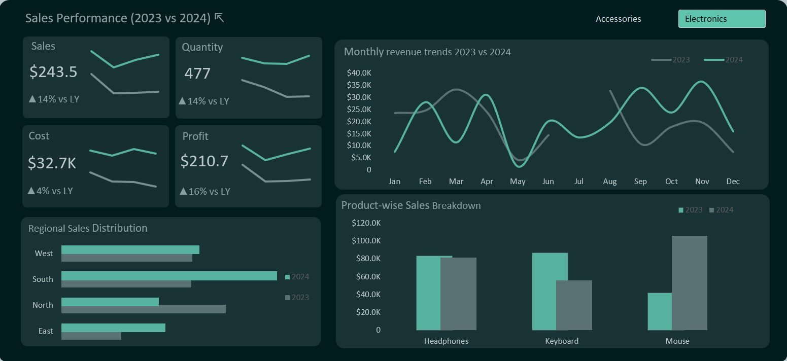

# Sales Performance & Analytics Dashboard (Microsoft Excel)

## Executive Summary
This project features an interactive **Sales Performance Dashboard** built in **Microsoft Excel** to evaluate multi-year business growth (2023 vs 2024). Leveraging **Pivot Tables, Power Query, Dynamic Charts, and KPI sparklines**, this dashboard tracks Year-over-Year (YOY) sales performance, profit margins, product-level revenue contribution, regional distributions, and seasonal order trends.

---

## Key Performance Indicators (KPIs - 2024 vs 2023)

- **Total Sales:** $243.5K (**▲ +14% vs LY**) | *Previous Year: $212.8K*
- **Total Profit:** $210.7K (**▲ +16% vs LY**) | *Previous Year: $181.4K*
- **Total Units Sold:** 477 units (**▲ +14% vs LY**) | *Previous Year: 420 units*
- **Total Cost:** $32.7K (**▲ +4% vs LY**) | *Previous Year: $31.4K*

---

## Key Business Insights & Findings

### 1. Revenue & Profitability Growth
- **Top-Line Growth:** Overall sales revenue grew by **14%** year-over-year, driven by a **14% increase in total unit sales** (from 420 to 477 units).
- **Margin Expansion:** Profit outpaced revenue growth with a **16% YOY increase**, indicating controlled operating costs (**only 4% YOY cost increase**).

### 2. Product Category Performance
- **Mouse Category Spike:** Sales for **Mouse** saw significant momentum, surging to become the top revenue contributor in 2024 (reaching ~$105.8K in total sales).
- **Headphones Stability:** Maintained consistent revenue across both years (~$83.7K in 2023 vs ~$81.6K in 2024).
- **Keyboard Re-alignment:** Experienced a decline in revenue from $87.0K in 2023 down to $55.9K in 2024, signaling a potential need for promotional push or product refresh.

### 3. Regional Distribution
- **South Region Dominance:** The **South** region leads overall sales performance, generating **$94.6K** in 2024 (up from $57.0K in 2023).
- **East & West Steady Growth:** Both **East** ($45.5K) and **West** ($60.5K) regions recorded positive year-over-year growth.
- **North Region Contraction:** Sales in the **North** region dropped from $72.1K in 2023 to $42.8K in 2024, highlighting a key territory for strategic review.

### 4. Monthly Trend Analysis
- **Seasonal Spikes:** Monthly trend lines highlight peak revenue periods during **November ($36.5K)** and **September ($34.0K)** in 2024, aligned with Q3/Q4 demand cycles.
- **Mid-Year Lull:** **May** recorded the lowest monthly sales ($1.5K in 2024), representing a recurring mid-year dip.

---

## Tech Stack & Methodology
- **Core Analytics Tool:** Microsoft Excel
- **Data Modeling & Summarization:** Excel Pivot Tables & Pivot Charts for flexible aggregation across time, product, and region
- **Calculations & Formulas:** Advanced formulas, percentage growth metrics, and YOY variance indicators
- **UI Design & Formatting:** Custom modern dark theme dashboard layout with dynamic slicers (e.g., *Accessories*, *Electronics*) and integrated sparklines

---

## Dashboard Preview

### Executive Visual Dashboard

---

## Strategic Recommendations
1. **Capitalize on South Region Momentum:** Expand distribution channels and inventory allocation in the **South** territory to support its high growth rate.
2. **Revitalize North Region & Keyboard Category:** Investigate root causes behind falling sales in the **North region** and the **Keyboard category** through targeted marketing or pricing discounts.
3. **Optimize Inventory Around Peak Months:** Prepare stock and supply chain operations for high-volume periods in **September and November**, while running promotion campaigns in **May** to flatten the mid-year drop.

---

## 📁 Repository Structure
